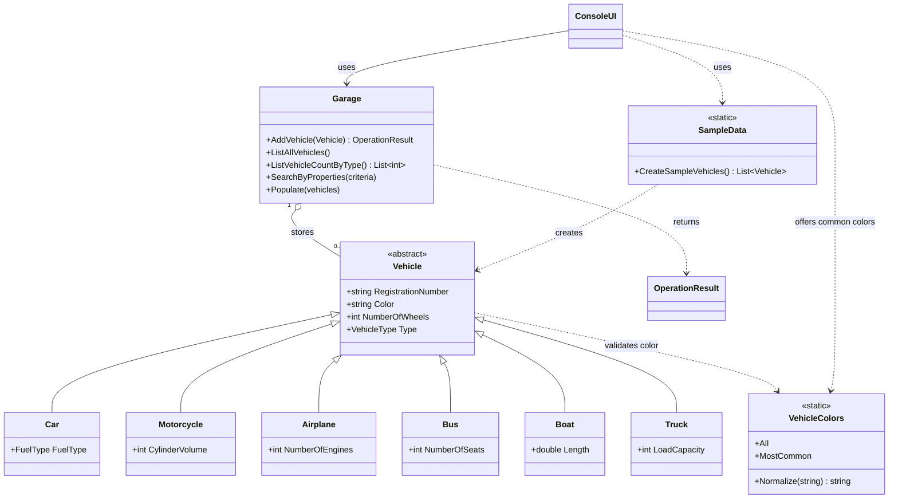

# Exercise 06 - Garage 2.0

A console application that manages a parking garage for vehicles. The solution is built with .NET 10 and includes a unit test project.

## Assignment

Build a console application that lets a user:

- Create a garage with a fixed number of parking spaces.
- Park vehicles of different types (motorcycle, airplane, car, bus, boat, truck).
- Remove vehicles and find them by registration number.
- List parked vehicles, count them by type, and search them by properties.

The implementation should follow these rules:

- Each vehicle has a unique registration number in the format **ABC123** or **ABC12D**. Input is trimmed and converted to uppercase, so `abc123` is stored as `ABC123`.
- Vehicles have a color and a number of wheels. The number of wheels cannot be negative. The color must be one of 20 predefined colors (Black, White, Silver, Gray, Red, Blue, Green, Yellow, Orange, Brown, Beige, Gold, Pink, Purple, Turquoise, Teal, Navy, Maroon, Bronze, Burgundy). Matching ignores case, and the color is stored in the list's casing.
- Each vehicle type has its own additional property (cylinder volume, number of engines, fuel type, number of seats, length, or load capacity).
- A garage cannot hold more vehicles than its capacity, and it cannot park two vehicles with the same registration number.

## Project structure

| Path | Purpose |
| --- | --- |
| `SolutionSetup\Program.cs` | Entry point. Starts the console UI. |
| `SolutionSetup\Garage\Garage.cs` | Stores parked vehicles and implements parking, removal, lookup, counting, and search. |
| `SolutionSetup\Vehicles\` | `Vehicle` base class, derived vehicle types, `VehicleType`, and `FuelType`. |
| `SolutionSetup\UI\` | Console user interface, split into partial class files per feature. |
| `SolutionSetupTests\` | xUnit tests for vehicles, the garage, and the console UI. |

## How the program works

1. **Start.** `Program.Main` creates a `ConsoleUI` that reads from the console and writes to the console, then runs the menu loop.
2. **Menu.** The UI prints the menu and reads one choice. Each choice calls a handler method:


3. **Validation.** Most operations need a garage, so the UI reports an error if option 1 has not been used yet. Invalid numbers and unknown menu choices print a message and the menu is shown again. Vehicle constructors validate their input and throw `ArgumentException` or `ArgumentOutOfRangeException`. The UI catches these and shows the message.
4. **Garage operations.** `Garage` returns an `OperationResult` for park and remove requests. The result carries a success flag and a message, which the UI prints. Lookups and searches return vehicles or lists directly.
5. **Error handling.** Unexpected exceptions are caught in the menu loop, so the application keeps running. Closed input or output streams end the loop.

## Running the application

```powershell
dotnet run --project Excercise06\SolutionSetup\SolutionSetup.csproj
```

## Running the tests

```powershell
dotnet test Excercise06\SolutionSetupTests\SolutionSetupTests.csproj
```



